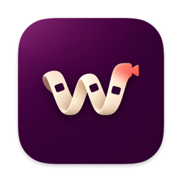

<p align="center">
  
</p>

<h1 align="center">Walk &amp; Roll</h1>

<p align="center">Walk through your app. Let the camera roll.</p>

Walk & Roll is a native macOS recorder for product demos and walkthroughs. Capture a window or display, add narration and a camera bubble, and save an MP4. Recordings are processed and saved on your Mac.

## Features

- Capture one window or display through the macOS sharing picker.
- Configure microphone and system audio independently.
- Add a rounded camera bubble in any corner.
- Highlight clicks and display commands or grouped typing, with counts for repeated keys.
- Play and scrub a preview after recording, with the camera and input overlays.
- Add focal-point zooms with eased motion, adjustable duration and magnification.
- Frame footage with equal margins and a soft shadow, or choose Plain.
- Export 30 fps H.264 MP4 with mixed AAC audio when enabled, then keep editing and export again.
- Preserve native capture dimensions up to 4K, or fit the recording into 1080p.

## Build and run

Requires macOS 15 or later, Python 3.9 or later, and Xcode 16 or compatible Command Line Tools. A paid Apple Developer membership is optional for local builds.

```sh
git clone https://github.com/wmartins/walk-and-roll.git
cd walk-and-roll
python3 scripts/build-local.py --release
open 'build/Walk & Roll.app'
```

The build command creates a local signing identity on first use and reuses it for later builds, helping macOS retain permission grants. Keep the ignored `.local-signing/` directory on your Mac across clean builds. It contains your local signing key and keychain.

Use `--sdk macosx` to select the active SDK explicitly. The build command prefers the compatible macOS 26.5 SDK when it is installed.

<details>
<summary>Build with full Xcode</summary>

Open `WalkAndRoll.xcodeproj`, or build and apply the same local signing identity from the command line.

```sh
xcodebuild -project WalkAndRoll.xcodeproj -scheme WalkAndRoll \
  -configuration Release -destination 'platform=macOS' \
  -derivedDataPath build/Xcode CODE_SIGNING_ALLOWED=NO build
python3 scripts/build-local.py --sign-existing 'build/Xcode/Build/Products/Release/Walk & Roll.app'
open 'build/Xcode/Build/Products/Release/Walk & Roll.app'
```

The project's default Xcode signing configuration is ad hoc. Use the commands above to retain the local signing identity across builds.

</details>

## Record

1. Choose **Choose Source…** and select a window or display. The app shows the source title, app name, and pixel size when available.
2. Set **Microphone** and **System audio**. Microphone capture uses the Mac's default input. Enable **Camera** and choose a bubble position if desired.
3. Enable **Show click highlights** or **Show keystrokes**. Keystrokes support **Commands only** and **All keystrokes**, adjustable typing groups, and a fade delay. Consecutive special keys and commands show counts such as `↩ ×3` or `⌘C ×2`.
4. Select **Start Recording**, then **Stop Recording**. The recording opens in a playable preview. Use the scrubber to seek, choose **Add Zoom**, and click a focal point in the footage or choose **Use Center**. Press Space to play or pause, or Escape to cancel zoom placement.
5. Select a zoom in the list to give it a name and change its duration or magnification, or choose **Remove**. Names identify zooms in the editor; unnamed zooms use labels such as **Zoom 1**. Renaming does not interrupt playback. The editing panel appears beside the video in a wide window and below it in a narrow window. Zooms ease in and out and stay within the source bounds. A later zoom shortens the earlier zoom, including its ease-out; at the same start time, the most recently added zoom wins. Camera bubbles and keystroke badges stay fixed while click highlights follow the screen content.
6. Choose **Save MP4…**. Successful, canceled, and failed exports all leave the recording available for further edits and another export while the app remains open. **Discard** releases the original recording and its edits so you can record again. Edits are held for the current session and are not restored after quitting.

**Sharper (native, up to 4K)** preserves the source's native pixel size. Enlarge a small window or move it to a Retina display before selecting it to capture more detail. **1080p** fits the source within 1920 × 1080 while preserving its aspect ratio. **Window Frame** is the default in the editor: equal margins, rounded corners, and a soft shadow on a neutral light background, without a black outline. It keeps the source’s proportions, with the frame included within the selected resolution limit. Under **Appearance → Frame**, choose **Plain** to remove the frame and use the source’s proportions. The preview follows the selected export resolution and effects. Original screen and camera media are not modified.

Zooms use the original capture pixels with bicubic enlargement for firmer text edges. Capture retains native detail up to the 4K limit even when **1080p** is selected for export, so lowering the export resolution does not reduce the original media’s detail. A 2× zoom uses half the source width and height; if that crop has fewer pixels than the output, some softness is unavoidable. A larger source window or a Retina display gives zooms more detail to work with.

## Permissions

macOS manages screen sharing through its picker. Optional features request **Microphone**, **Camera**, or **Input Monitoring** access when enabled. Manage access under **System Settings → Privacy & Security**.

**All keystrokes** makes typed text visible in the video. Window recordings show input while the captured app has focus. Secure Keyboard Entry pauses keyboard capture.

After switching from an older signing identity, quit the app, remove its old Input Monitoring entry, add the current app, enable it, and reopen it. Subsequent builds made with the same local identity should retain that grant.

## License

Walk & Roll is source-available under the **MIT License with Commons Clause v1.0**. You can build, modify, and use it for personal or commercial work, including creating paid videos and product demos.

Selling the software, or a product or service whose value derives substantially from its functionality, requires separate permission from William Martins. The clause's definition also covers certain paid hosting, consulting, and support arrangements. See [LICENSE](LICENSE) for the full terms.
